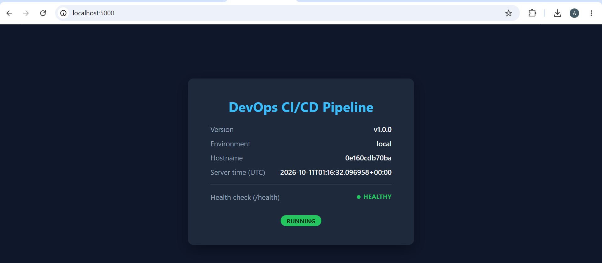

# v1: Containerization

A small Flask app packaged as a Docker image. It's the starting point of this repo, and every later version deploys this same image.



## Why

"It works on my machine" is a real problem. The app needs a specific Python version and a handful of libraries, and a server is never set up exactly like my laptop. A container image carries all of that along, so what I test locally is what runs everywhere else.

I started here because everything that follows (Kubernetes, Helm, the CI/CD pipelines, the cloud deployments) works with images. There's no point building any of that until the image itself is solid.

## What I built

The app is deliberately tiny, so the focus stays on the tooling around it. It has three endpoints:

- `/` is a dashboard showing the app version, environment, container hostname and server time
- `/api/status` returns the same information as JSON
- `/health` returns `200` while the app is up, and Kubernetes will probe it later

The hostname is on the dashboard for a reason: once there are several replicas behind a service, it tells me which one answered.

The Dockerfile is short, but a few choices in it are worth a mention. It starts from `python:3.12-slim` to keep the image small (around 200 MB), installs dependencies before copying the code so Docker can reuse that cached layer on rebuilds, and runs the app as a non-root user. The version and environment name come from the `APP_VERSION` and `APP_ENV` variables, so the same image can be configured per environment without rebuilding. There's also a built-in health check that calls `/health` every 30 seconds.

It runs on Flask's built-in development server, which is fine for a demo but not something I'd use in production.

## Testing it

All commands run from the repo root. First, build the image and start a container:

```bash
docker build -f docker/Dockerfile -t devops-app:v1.0.0 .
docker run -d --name devops-app -p 5000:5000 devops-app:v1.0.0
docker ps
```

After a few seconds `docker ps` should show `Up ... (healthy)`. The `healthy` part comes from the health check described above.

Check the endpoints, then open <http://localhost:5000> in a browser:

```bash
curl -i http://localhost:5000/health
curl -i http://localhost:5000/api/status
```

Both return `200 OK`. The browser should show the dashboard with version `v1.0.0`, environment `local`, and the container ID as the hostname.

Confirm the app isn't running as root:

```bash
docker exec devops-app whoami
```

This prints `appuser`. Then run the same image as a "staging" environment on a different port:

```bash
docker run -d --name devops-app-staging -p 5001:5000 -e APP_ENV=staging devops-app:v1.0.0
curl http://localhost:5001/api/status
```

The response says `"environment":"staging"` and shows a different hostname, even though nothing was rebuilt.

If you want to see the health check history Docker keeps, this shows the status and the last few results:

```bash
docker inspect --format '{{json .State.Health}}' devops-app
```

When you're done, remove both containers. The image stays, so you can start new containers from it any time:

```bash
docker rm -f devops-app devops-app-staging
```

## What's next

Version 2 takes this same image to Kubernetes, running locally with `kind`, with separate dev, staging and production namespaces.
